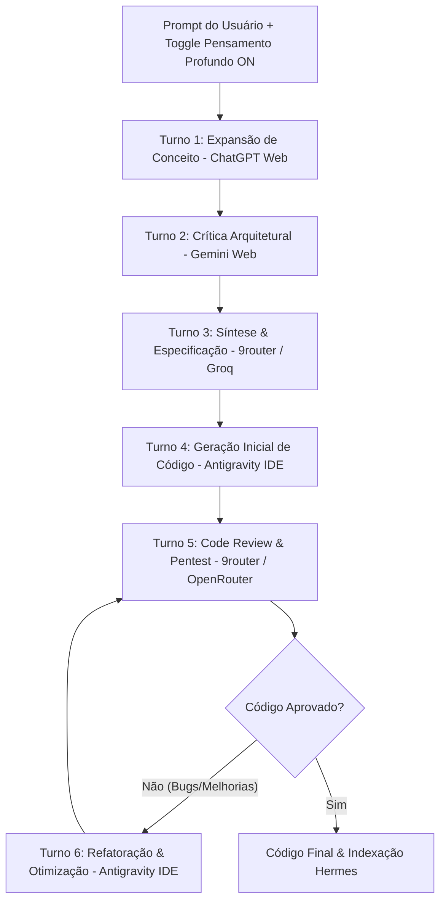
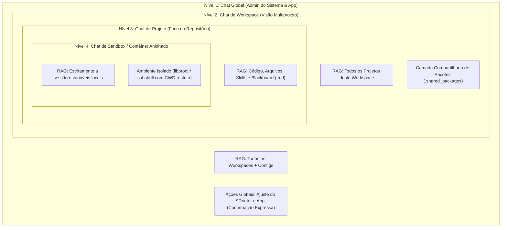

# Idealização & Conceito do Projeto (GDD)
## Orquestrador Multi-Agentes de 3 Camadas (LLM Routing & Debate Automation)

---

## 💡 1. Visão Geral & Propósito do Projeto

O **Orquestrador Multi-Agentes de 3 Camadas** é um ecossistema de software projetado para maximizar a capacidade de raciocínio, disponibilidade e eficiência de Modelos de Linguagem (LLMs), operando sob uma premissa estrita de **custo zero** e **alta resiliência**.

O sistema resolve três grandes limitações do uso convencional de IAs:
1. **Limites de Uso (*Rate Limits*) e Bloqueios:** Transiciona automaticamente entre diferentes provedores e camadas caso um modelo fique indisponível, sofra alteração de layout no site ou atinja a cota gratuita.
2. **Latência e Custos de Rede:** Executa tarefas simples ou locais no próprio dispositivo do usuário sem depender da nuvem.
3. **Qualidade de Raciocínio Monolítico:** Em vez de confiar no retorno de uma única IA, estabelece uma "sala de conferência" (debate colaborativo) com ciclo de aprimoramento incremental de código, onde múltiplos modelos analisam, criticam, sintetizam, constroem e revisam o software antes da entrega final.

---

## 🛠️ 2. Mapeamento de Ferramentas e IAs por Camada

Para prever o comportamento exato do sistema, as ferramentas e modelos são categorizados de forma transparente:

| Camada | Tipo de Ferramenta | Provedores & Modelos Alvo | Método de Conexão | Função Principal |
| :--- | :--- | :--- | :--- | :--- |
| **Camada 3** | Official Web & IDEs (Superfície) | • Antigravity IDE (Gemini 2.5 / Claude)<br>• ChatGPT Web (GPT-4o / GPT-4o-mini)<br>• Gemini Web (Gemini Advanced / Flash) | • Playwright RPA (PC)<br>• Android Accessibility Service & WebView Headless (Mobile)<br>• Contexto Direct IDE | Raciocínio pesado, arquitetura, crítica profunda e geração inicial de código. |
| **Camada 2** | APIs Externas Não-Locais (Intermediária) | • Groq Cloud (Llama 3.3 70B, Llama 3.1 8B, Mixtral)<br>• OpenRouter Free (DeepSeek-R1 / V3, Qwen 2.5 Coder)<br>• 9router Proxy Hub (Fallback Automático) | • API REST JSON (`/v1/chat/completions`) | Roteamento rápido, síntese de consenso, sanitização, mediação e fallback imediato sem custo. |
| **Camada 1** | Inferência Local & Agente Embutido (Profunda) | • Hermes Agent (NousResearch)<br>• Gemma 2B / Llama 3.2 3B Quantizado<br>• Servidores MCP Internos | • Chaquopy JVM (Android Nativo)<br>• Llama.cpp Server (`localhost:8080`) | Operação local/offline, autonomia agêntica direta no SO, manipulação de arquivos e RAG local. |

---

## 🔄 3. O Fluxo do Debate Moderado & Aprimoramento Incremental de Código (Modo "Pensamento Profundo")

O fluxo de debate colaborativo em **7 turnos padronizados** com o **Padrão Blackboard** (histórico vivo em `conferencias/<nome-do-projeto>/projeto_atual.md`) opera como o motor do **Modo "Pensamento Profundo" (*Deep Deliberation / Deep Thinking*)**:

* **Modo Padrão (Agente Rápido):** Na operação cotidiana, o usuário interage diretamente com o **Hermes Agent** em diálogo fluido e respostas sub-segundo/imediatas via provedor mais rápido do 9Router (Groq/DeepSeek) ou inferência local, chamando ferramentas MCP sob demanda sem disparar a conferência completa.
* **Modo Pensamento Profundo (Mesa Redonda Opcional):** Acionado sob demanda pelo usuário via chave de seleção (*toggle switch*) na interface para tarefas complexas, arquiteturas críticas ou refatoração profunda de código. Quando ativado, a requisição desencadeia a conferência em 7 turnos:



### Detalhamento dos Turnos:
1. **Turno 1 - Expansão de Conceito (ChatGPT Web / GPT-4o):** Analisa a intenção bruta do usuário e gera uma proposta arquitetural abrangente.
2. **Turno 2 - Crítica & Regras de Borda (Gemini Web / Gemini Flash):** Questiona gargalos, falhas de lógica, concorrência e riscos de segurança da proposta do Turno 1 (sem escrever código ainda).
3. **Turno 3 - Síntese de Consenso (9router - Llama 3.3 70B via Groq):** Filtra o debate, remove contradições e gera um blueprint técnico enxuto em Markdown.
4. **Turno 4 - Geração Inicial de Código (Antigravity IDE / Modelo de Código):** Consome a síntese do Turno 3 e constrói a primeira versão funcional dos arquivos de código.
5. **Turno 5 - Code Review & Audit de Segurança (Gemini Web ou DeepSeek via OpenRouter):** Inspeciona o código gerado no Turno 4 em busca de bugs, vazamentos de memória, erros de sintaxe ou violação de Clean Architecture.
6. **Turno 6 - Refatoração & Aprimoramento (Antigravity IDE):** Aplica as correções apontadas no Turno 5, refatorando o código para sua versão definitiva e otimizada.
7. **Turno 7 - Loop de Feedback de Testes (Iterativo):** Se a execução do código no ambiente local reportar erro ou falha de teste, o log do erro é inserido no `.md` e o fluxo retorna ao Turno 5 para correção guiada.
8. **Modo Observador Passivo (Hermes Local):** Absorve o documento finalizado para indexação local de conhecimento (RAG/Embeddings).

---

## 🔀 4. Fluxos Opcionais de Contingência (Fallbacks & Comportamentos Esperados)

Para garantir resiliência total, o Maestro (Gateway Python) avalia continuamente a saúde das conexões e serviços, aplicando desvios automáticos:

### Cenário A: Operação Nominal (Todas as Camadas Online)
* **Comportamento Esperado:** Execução completa dos 7 Turnos com máxima qualidade e verificação cruzada entre Web RPA, APIs e Antigravity IDE.

### Cenário B: Bloqueio/Quebra de Web Scraping na Camada 3 (CAPTCHA, Timeout ou Mudança de Layout)
* **Condição de Disparo:** Falha no script Playwright (ex: elemento CSS não encontrado ou timeout de 15s).
* **Comportamento Esperado:**
  1. O Maestro registra o alerta no log e isola a ferramenta web com falha.
  2. Redireciona os papéis de Expansão/Crítica para a **Camada 2** (usando DeepSeek-R1 / Llama 3.3 70B via OpenRouter / Groq no 9router).
  3. A geração final de código permanece na **Antigravity IDE** via contexto do projeto.

### Cenário C: Queda Parcial de Rede / Rate Limit em APIs Externas (Camada 2 Instável)
* **Condição de Disparo:** Retorno de código de erro HTTP `429 Too Many Requests` ou `503 Service Unavailable` em proxies do 9router.
* **Comportamento Esperado:**
  1. O Maestro realiza a rotação automática de chave/endpoint dentro do 9router.
  2. Se todos os proxies da Camada 2 falharem, o fluxo simplifica o debate executando a síntese via **Hermes Local (Camada 1)**.

### Cenário D: Queda Total de Internet / Modo Offline Absolute
* **Condição de Disparo:** Falha de ping em DNS externo ou ausência de interface de rede ativa.
* **Comportamento Esperado:**
  1. O Maestro chaveia 100% da operação para a **Camada 1 (Hermes Local)**.
  2. O loop de debate reduz-se a um fluxo enxuto de 2 turnos (Rascunho Local $\rightarrow$ Refatoração Local) para preservar CPU/bateria do aparelho.

### Cenário E: Requisição Trivial de Baixa Complexidade
* **Condição de Disparo:** Prompt com contagem de tokens reduzida (< 150 tokens) ou palavras-chave de utilitários (ex: *"gerar regex de email"*, *"formatar JSON"*).
* **Comportamento Esperado:**
  1. O Maestro desativa o loop longo de debate.
  2. Despacha a requisição diretamente para o modelo ultra-rápido no Groq (Camada 2 - resposta sub-segundo) ou Hermes Local (Camada 1), economizando tempo do usuário.

---

## 📁 5. Arquitetura de Workspaces, Projetos, Sandboxes Aninhados & Camadas de Chats

Inspirado no modelo de isolamento e governança de ambientes agênticos avançados (como o Antigravity IDE), o sistema organiza o ambiente mobile e desktop em uma **hierarquia estrita de 4 níveis de contexto, persistência e privilégios**:



---

### 5.1. A Matriz das 4 Camadas de Chats & RAG (Escopos de Contexto)

Em vez de uma lista plana de conversas, o usuário e a IA operam em escopos rigorosamente delimitados:

| Camada | Escopo de Contexto & RAG | O que a IA Consegue Acessar | Privilégios & Capacidades Especiais |
| :--- | :--- | :--- | :--- |
| **1. Chat Global** | **Global do Dispositivo** | Enxerga todos os workspaces cadastrados, métricas de hardware, logs agregados e configurações do app. | **Administração Geral:** Gerencia chaves de API, ajusta rotas do 9Router, cadastra modelos e altera configurações do app *(sempre exigindo confirmação explícita do usuário)*. |
| **2. Chat de Workspace** | **Multi-Projeto** | Enxerga todos os projetos dentro daquele Workspace específico (ex: relaciona a documentação de um app com o código de outro repositório). | Ideal para arquitetura de sistemas distribuídos, orquestração entre múltiplos projetos e refatorações amplas entre módulos. |
| **3. Chat de Projeto** | **Projeto Específico** | Estritamente os arquivos da pasta do projeto, seu histórico de chats, Quadro Branco (`.md`), branches Git e notas locais. | Focado em implementação de código, depuração, testes e governança técnica do repositório ativo. |
| **4. Chat de Sandbox** | **Isolamento Confinado** | Apenas as variáveis de execução daquele script e o ambiente virtual do contêiner. Zero vazamento para fora. | Testes experimentais de scripts sujos, execução de código gerado não confiável e simulações rápidas. |

---

### 5.2. Localização em `Documentos/` e Escape Confinado (Quebra Controlada de Sandbox)

* **Diretório Raiz Padrão no Android:**
  O aplicativo cria e gerencia toda a árvore de trabalho na pasta pública padrão de documentos do dispositivo:
  ```text
  /sdcard/Documents/MaestroWorkspaces/
  ├── Workspace-Dev/
  │   ├── .shared_packages/          # Pacotes Python e binários compartilhados do Workspace
  │   ├── Projeto-Maestro/
  │   │   ├── hermes.yaml            # Configuração nativa do agente do projeto
  │   │   ├── skills/                # Habilidades especializadas do projeto
  │   │   ├── src/                   # Código-fonte
  │   │   ├── conferencias/          # Blackboard vivo (projeto_atual.md)
  │   │   └── .sandboxes/            # Contêineres e sandboxes fixos do projeto
  │   └── Projeto-WebApp/
  └── Workspace-Estudos/
  ```
* **Escape Confinado (Permissão Explícita para Acesso Externo):**
  * Por padrão, a IA só tem permissão de leitura e escrita restrita à pasta do seu projeto/workspace.
  * Caso o usuário peça no chat para o agente manipular um arquivo externo (ex: *"Hermes, resuma a planilha que está em /sdcard/Download/despesas.xlsx"*), o middleware de governança **bloqueia a ação imediatamente** e exibe um pop-up de segurança nativo na UI:
    > ⚠️ **Acesso Externo Solicitado**  
    > O agente deseja acessar um arquivo fora do workspace atual:  
    > Caminho: `/sdcard/Download/despesas.xlsx`  
    > Operação: `Leitura`  
    > `[ Negar ]` `[ Permitir Desta Vez ]` `[ Permitir Sempre neste Chat ]`

---

### 5.3. Sandboxes & Contêineres Aninhados com Camada Compartilhada de Pacotes (*Shared Layering*)

Para viabilizar execução de código com máxima economia de armazenamento e zero perda de tempo no Poco X7 Pro:

1. **Permanência e Cota Rígida por Projeto:**
   * Os sandboxes/contêineres são **fixos e persistentes** (mantendo dependências instaladas entre reinicializações do app).
   * Cada projeto possui uma cota máxima configurável (padrão: **máximo de 3 contêineres/sandboxes por projeto**), impedindo o acúmulo descontrolado de pastas virtuais e processos zumbis na memória.
2. **Herança em Camadas (*Shared Layering* sem Duplicação):**
   * **Instalação no Nível Superior (Workspace):** Quando um pacote Python (`pip install`) ou binário de sistema for instalado em um contêiner, o instalador verifica se a biblioteca já existe na camada compartilhada do Workspace pai (`.shared_packages`).
   * **Se já existir:** O contêiner filho herda o pacote instantaneamente via inclusão no `PYTHONPATH` (`PYTHONPATH=/sdcard/Documents/MaestroWorkspaces/<workspace>/.shared_packages:$PYTHONPATH`) ou via Bind Mount de `/shared/bin` para `/usr/local/bin`, consumindo **zero espaço em disco adicional e zero tempo de download**.
   * **Se não existir:** O pacote é instalado diretamente na camada compartilhada do Workspace (salvo solicitação em contrário), ficando disponível imediatamente para todos os outros projetos e contêineres irmãos.
   * **Sobrescrita Local de Versão (*Local Overrides*):** Se um projeto exigir uma versão conflitante específica (ex: `pydantic==1.10` em vez de `pydantic==2.0`), o pacote local é instalado no diretório privado daquele sandbox, tendo prioridade na ordem de resolução do `PYTHONPATH`.

---

### 5.4. Template Padrão de Novos Projetos (Espelhado no Padrão Nativo do Hermes Agent)

Para manter 100% de interoperabilidade com o ecossistema oficial do **Hermes Agent (NousResearch)** sem criar formatos proprietários, o template de novos projetos adota nativamente a estrutura declarativa do Hermes:

* **Estrutura Gerada ao Criar Novo Projeto:**
  ```text
  <nome-do-projeto>/
  ├── hermes.yaml            # Configuração declarativa do agente (modelos, endpoint 9Router, tools ativas)
  ├── skills/                # Diretório de habilidades especializadas (prompts e scripts do projeto)
  ├── src/                   # Diretório de código-fonte e módulos de desenvolvimento
  ├── docs/                  # Documentações técnicas e histórico
  ├── conferencias/          # Histórico permanente do Blackboard (projeto_atual.md)
  └── .sandboxes/            # Instâncias persistentes de sandbox/contêiner (até 3)
  ```
* **Vantagens da Adoção do Padrão Hermes:**
  1. Qualquer skill criada pela comunidade para o Hermes Agent pode ser copiada diretamente para a pasta `skills/` do projeto e utilizada instantaneamente.
  2. As configurações de system prompt, permissões de ferramentas e temperatura são editáveis diretamente no arquivo `hermes.yaml` ou pelo painel visual do aplicativo.
  3. Preserva o isolamento de cada projeto, permitindo que cada um tenha suas próprias skills e ferramentas MCP ativadas sob medida.

---

## 🖥️ 6. Interfaces de Uso & Funcionalidades Detalhadas do Usuário Final

Para garantir que o usuário tenha **controle total, visibilidade transparente e alta operabilidade**, o sistema disponibiliza um catálogo expandido de funcionalidades acessíveis por múltiplos pontos de entrada.

### 6.1. Catálogo Expandido de Funcionalidades do Usuário

#### 💬 A. Interação & Comunicação com IAs
1. **Visualização em Tempo Real do Debate ("Mesa Redonda" Streaming):**
   * *Funcionamento:* Acompanhamento ao vivo e em streaming da conversa entre as IAs. Cada turno exibe um card com o nome do agente, seu papel no loop (Expansão, Crítica, Síntese, Código, Audit, Otimização), a camada de processamento ativa e o texto sendo gerado em tempo real.
2. **Chat de Interação Direta no Fluxo (In-Stream Direct Chat):**
   * *Funcionamento:* Permite que o usuário envie mensagens e comandos DIRETAMENTE para a Mesa Redonda no meio do debate. O usuário atua como participante ativo da conferência (ex: *"Usuário: Por favor, altere a síntese para utilizar o banco SQLite local"*). Suporta menções diretas com `@` para direcionar instrução a uma IA específica (ex: `@Gemini refaça a análise focando em concorrência`).
3. **IA Dedicada Externa ao Fluxo (Assistente de Suporte, Árbitro & Coletor):**
   * *Funcionamento:* Um agente de IA dedicado (configurável, ex: Hermes Local ou Groq rápido) que opera FORA da Mesa Redonda e exerce três papéis estratégicos:
     * **IA Árbitro (Juiz de Impasse):** Invocado automaticamente se duas IAs no debate entrarem em contradição insolúvel ou loop de divergência, dando o voto de minerva imparcial.
     * **IA Coletor (Web Searcher & Retriever):** Busca documentações técnicas externas, código atualizado ou dados locais sob demanda e injeta as referências diretamente no `.md` sem interromper a conferência principal.
     * **Assistente de Dúvidas do Usuário:** Chat isolado e permanente onde o usuário tira dúvidas pontuais sobre a arquitetura do software sem poluir a memória do debate.

#### 📊 B. Telemetria, Cotas & Diagnóstico de Hardware
4. **Monitor de Cotas de Tokens & Cronômetro de Reset:**
   * *Funcionamento:* Exibe o consumo acumulado de tokens de entrada e saída por provedor (Groq Cloud, OpenRouter, ChatGPT Web, Gemini Web). Inclui cronômetros regressivos dinâmicos indicando exatamente quanto tempo falta para o reset das cotas gratuitas diárias/horárias de cada serviço.
5. **Identificação Transparente de Modelos & Origem Ativa:**
   * *Funcionamento:* Marcação clara em cada mensagem do debate especificando a **Origem** (Camada 3 Web RPA, Camada 2 API 9router, Camada 1 Hermes Local), o **Provedor de Hospedagem** (OpenAI, Google, Groq, OpenRouter, Hardware Local) e o **Modelo Específico** (ex: `gpt-4o-mini`, `llama-3.3-70b-versatile`, `gemma-2b-q4`).
6. **Telemetria de Hardware Local (RAM, VRAM, CPU & Latência):**
   * *Funcionamento:* Monitoramento contínuo dos recursos do aparelho. Exibe a quantidade exata de memória RAM e VRAM alocada pelos modelos locais (Hermes / Llama.cpp), uso de CPU, latência da primeira resposta (TTFT - *Time to First Token*) e velocidade de geração em tokens por segundo (t/s).

#### 📁 C. Gerenciamento de Projetos, Arquivos & Governança
7. **Gerenciador Avançado de Pastas, Projetos & Workspaces:**
   * *Funcionamento:* Explorador de arquivos e gerenciador de projetos integrado. Permite criar novos projetos, alternar entre workspaces existentes, duplicar estruturas, criar subpastas e aplicar modelos de governança da pasta `Diretrizes/`. Inclui gerador de backups compactados (`.tar.gz`) do projeto ativo.
8. **Navegação para Ambiente Limpo (*Clean Slate* via Pasta Vazia):**
   * *Funcionamento:* Alternância/criação de uma nova pasta de projeto vazia, garantindo que a nova sessão inicie sem contexto de conversas anteriores carregado, enquanto preserva 100% intactos os logs e contextos de projetos passados em suas respectivas pastas.
9. **Leitor/Editor Vivo do Quadro Branco (`.md`):**
   * *Funcionamento:* Visualizador Markdown integrado e sincronizado ao vivo com o arquivo `conferencias/<projeto>/projeto_atual.md`. Permite que o usuário insira anotações manuais ou edite o contexto antes de disparar o próximo turno.

#### ⚙️ D. Configuração, Controle Manual & Ferramentas Úteis
10. **Gerenciador & Adição Manual de Novas IAs/Provedores:**
    * *Funcionamento:* Painel de configuração onde o usuário pode cadastrar manualmente novas chaves API (Groq/OpenRouter), registrar novos endpoints REST compatíveis com a OpenAI, adicionar conectores para novas IAs Web (ex: Claude Web, DeepSeek Web) ou ajustar rotas do 9router.
11. **Controle de Fluxo Manual & Intervenção Humana (*Override*):**
    * *Funcionamento:* Botões de controle para **Pausar o Debate** a qualquer momento, **Forçar a Troca de Agente** (ex: substituir Gemini por DeepSeek no próximo turno), **Editar a Resposta da IA** antes de passar a bola, ou **Forçar o Modo 100% Offline**.
12. **Sistema de Replay & Testes A/B de LLMs:**
    * *Funcionamento:* Permite reprisar debates anteriores alterando modelos ou parâmetros de sistema para comparar visualmente qual combinação de IAs gerou o código de melhor qualidade.
13. **Exportador Automático de Documentação (DocGen):**
    * *Funcionamento:* Compila automaticamente a árvore do projeto, o histórico do debate e os arquivos de código em documentos finais formatados (PDF, HTML, README.md, GDD e especificação de API).
14. **Modo Sandbox de Execução Segura de Código:**
    * *Funcionamento:* Ambiente de testes isolado que compila e executa o código gerado nos Turnos 4 e 6 em um subprocesso seguro, injetando o resultado do teste de execução diretamente no Turno 7 para correção imediata.

---

### 6.2. Modos de Acesso & Experiência do Usuário (UX)

O usuário acessa todas as funcionalidades acima através de **4 interfaces dedicadas**:

#### A. Dashboard Web Local (Navegador - SPA)
* **Acesso:** `http://localhost:8000/dashboard` (Interface gráfica leve em HTML5/CSS Vanilla com WebSockets).
* **Navegação por Abas:**
  * 💬 **Aba "Debate ao Vivo":** Painel principal em 3 colunas (Árvore de arquivos, Chat ao vivo streaming dos 7 turnos com injeção in-stream, e Quadro Branco `.md` sincronizado com chat de suporte).
  * 📊 **Aba "Telemetria & Cotas":** Dashboard gráfico com velocímetros de consumo de memória, medidores de latência (ms e t/s) e cartões de cotas de API com contagem regressiva para reset.
  * ⚙️ **Aba "Gerenciador de IAs":** Formulário intuitivo para cadastrar chaves, registrar modelos e gerenciar rotas de fallback do 9router.
  * 📁 **Aba "Workspaces & Projetos":** Explorador visual de projetos com opções de clonagem, backup, exportação e navegação para ambiente limpo (*Clean Slate*).
  * 🧪 **Aba "Replay & Sandbox":** Ferramenta para testes A/B de modelos e ambiente isolado para execução de código gerado.

#### B. Interface CLI de Terminal (`maestro-cli`)
* **Acesso:** Linha de comando no terminal (`python3 -m maestro` ou `./maestro-cli`).
* **Navegação Interativa (Rich TUI):**
  * Painel dividido no terminal com cores vibrantes destacando o papel de cada IA, velocidade (t/s) e consumo de memória.
  * Menu de navegação por atalhos de teclado: `Tab` para alternar entre telas e `Ctrl+P` para pausar o debate e intervir manualmente.
  * **Comandos Diretos:** `maestro --project <nome>`, `maestro --status`, `maestro --add-ai`, `maestro --offline`, `maestro --arbitrate`, `maestro --export`.

#### C. Gateway Proxy Transparente (OpenAI API Compatible)
* **Acesso:** `http://localhost:8000/v1/chat/completions`.
* **Uso:** Conexão direta com IDEs (Antigravity IDE, VS Code, Cursor). Os metadados de telemetria (cotas, RAM, modelo ativo e camada) são transmitidos nos cabeçalhos HTTP da resposta (`X-Maestro-Layer`, `X-Maestro-Model`, `X-Maestro-RAM-Used`, `X-Maestro-Quota-Reset`).

#### D. Aplicativo Nativo Android (APK Unificado - Sistema Operacional Agêntico)
* **Acesso:** Aplicativo nativo instalado via sideload no smartphone (alvo: Poco X7 Pro com HyperOS, 12 GB RAM / 512 GB).
* **Interface Central (Baseada na Web UI do Hermes Agent / Open WebUI):**
  * O app recria visual e funcionalmente a interface consagrada da comunidade para o **Hermes Web Dashboard**, adaptada nativamente para Android em **Jetpack Compose**.
  * **Sidebar Lateral Deslizante:** Lista de sessões de chat anteriores, alternador de workspaces por projeto, atalho direto para o Explorador de Arquivos (ZArchiver) e painel de configurações de Provedores/Chaves.
  * **Área de Mensagens com Cards de Tool-Calling:** Cada execução de ferramenta MCP (leitura/escrita de arquivos, comandos de terminal, varredura de rede) é exibida em cartões colapsáveis limpos com status de execução (`Status 200 OK`, parâmetros e saída), sem poluir visualmente a conversa.
  * **Barra de Ações Rápidas (Toggles Superiores ao Prompt):**
    * `[🧠 Pensamento Profundo: ON/OFF]`: Ativa ou desativa a Mesa Redonda de 7 turnos.
    * `[👁️ Consciência de Tela: ON/OFF]`: Ativa ou desativa a captura via MediaProjection.
  * **Barra de Entrada:** Campo de texto com anexos locais (`+`), gravação de voz contínua (`🎙️`) e seleção rápida de modelos.
* **Estrutura de Código:** Frontend nativo em **Kotlin + Jetpack Compose** com backend lógico e orquestrador embutido via **Chaquopy (Python NDK)**.
* **Operação:** Consolida em um único app o explorador de arquivos estilo ZArchiver, editores nativos, servidores MCP, navegação web invisível, automação em outros apps, diagnósticos de rede e comunicação por voz.

---

## 🛠️ 7. Automação de Interface & RPA Persistente

Para viabilizar a utilização das plataformas oficiais da Camada 3 sem custos de API:
* **No PC (Linux):** Automação de navegador via **Playwright Python** operando com **Contexto Persistente** (`user_data_dir`), mantendo a sessão ativa e logada no navegador do usuário.
* **No Celular (Android Nativo):**
  * **Navegação Web Real:** Componente nativo `WebView` em segundo plano com injeção de JavaScript para extração do DOM e simulação de cliques/preenchimentos guiados pelo agente.
  * **Automação de Apps Externos:** Implementação nativa de um `Accessibility Service` que permite ao agente inspecionar a hierarquia visual de outros aplicativos instalados e executar ações autônomas.
  * **Consciência de Tela (Opcional via Toggle):** Integração da `MediaProjection API` com **ativação desativável por chave**. Fica **desligada por padrão** para garantir privacidade absoluta, zero consumo de bateria e economia de GPU, sendo ligada pelo usuário apenas quando desejar que a IA "veja" o conteúdo da tela ativa.

---

## 📱 8. Especificação da Arquitetura Mobile Nativa (Android / Poco X7 Pro)

Esta seção formaliza as decisões de engenharia para a execução do agente em ambiente mobile nativo, eliminando a dependência de ambientes de terminal externos:

### 8.1. Decisão Arquitetural: App Único Autocontido vs Ambientes de Emulação
1. **Abandono do Termux / Proot Externo:**
   * Evita a complexidade operacional de manter contêineres Linux e servidores paralelos rodando manualmente em segundo plano.
   * Elimina problemas de perda de foco e fragmentação de interfaces.
2. **Inviabilidade do Shizuku como Solução de Sistema:**
   * A partição `/system` do Android moderno é estritamente somente-leitura e protegida por integridade criptográfica (*dm-verity*), impossibilitando instalar interpretadores diretamente no sistema sem Root real (Magisk/KernelSU).
   * O Shizuku opera no nível ADB (UID 2000) e exige pareamento recorrente por Depuração sem Fio (*Wireless Debugging*) a cada reinicialização, quebrando a autonomia do app.
3. **Adoção do Chaquopy (Python NDK Integrado):**
   * O interpretador Python roda diretamente dentro da JVM do APK como biblioteca nativa compilada com a Android NDK.
   * Executa os scripts do Hermes Agent, servidores MCP e lógica do Maestro sem requerer root, ADB ou ferramentas externas.

### 8.2. Permissões Críticas & Sobrevivência no HyperOS (Xiaomi)
1. **Acesso Global ao Armazenamento (`MANAGE_EXTERNAL_STORAGE`):**
   * Declaração de "Acesso a todos os arquivos" no `AndroidManifest.xml` para contornar as restrições do *Scoped Storage*, permitindo que o agente leia, edite, organize e crie pastas em todo o armazenamento interno (`/sdcard`).
2. **Blindagem contra Encerramento Agressivo (HyperOS Battery Killer):**
   * **Foreground Service Contínuo:** O app mantém um serviço em primeiro plano associado a uma notificação persistente na barra de status, impedindo que o sistema operacional encerre o processo do agente durante execuções longas.
   * **Configurações Manuais do Dispositivo:** Ativação de "Início Automático" (*Autostart*) e alteração da economia de bateria para "Nenhuma restrição" nas propriedades do APK no HyperOS.
3. **Gatilhos por Eventos e Cron Agêntico:**
   * Integração de `WorkManager` e `BroadcastReceiver` nativos do Android para despertar o agente mediante eventos de sistema (conexão a redes Wi-Fi específicas, variação de bateria, recepção de arquivos) ou rotinas agendadas (verificação diária matinal de logs e pendências).

### 8.3. Roteamento de Inferência via 9Router (Preservação de Hardware)
* **Desoneração de Memória:** A inferência pesada de modelos de linguagem é 100% transferida para provedores em nuvem gratuitos via proxy local **9Router** (`http://127.0.0.1:20128/v1`).
* **Consumo Estimado no Poco X7 Pro:** O APK com Kotlin e Chaquopy consome entre **200 MB e 400 MB de RAM**, operando com extrema folga nos 12 GB de LPDDR5X do dispositivo. O tamanho do APK fica entre **100 MB e 250 MB**, ocupando fração desprezível dos 512 GB de armazenamento.
* **Fallback Automático e Resiliência:** Caso um provedor gratuito atinja limite de taxa (erro 429) ou apresente instabilidade, o 9Router repassa a requisição imediatamente ao próximo provedor configurado, garantindo continuidade do raciocínio agêntico.

#### 8.3.1. Rota 1 Zero-Key & Onboarding Agêntico Out-of-the-Box
Para eliminar a fricção da "tela em branco" no primeiro uso, o aplicativo inicia de fábrica **pronto para conversar sem exigir chaves prévias do usuário**:

1. **Origem dos Modelos Comunitários Gratuitos (Zero-Key):**
   * **OpenRouter Free Tier:** Modelos abertos mantidos por infraestruturas patrocinadas com sufixo `:free` (`meta-llama/llama-3.3-70b-instruct:free`, `qwen/qwen-2.5-coder-32b-instruct:free`, `deepseek/deepseek-r1:free`).
   * **Proxies Comunitários & OpenCode / AgentRouter:** Pools de nós comunitários que expõem endpoints compatíveis com a OpenAI API para uso livre.
   * **Cloudflare Workers AI:** Cota diária de requisições gratuitas sem necessidade de cartão de crédito.
2. **Análise de Segurança & Privacidade de Dados:**
   * **No Onboarding / Setup Inicial (Risco Zero):** O diálogo de primeiro uso envolve apenas saudações, ajuda técnica e instruções de configuração, sem tráfego de dados confidenciais ou código privado.
   * **Recomendação para Dados Sensíveis:** Em provedores públicos comunitários não há garantia de *Zero Data Retention*. Para projetos com código confidencial, arquivos pessoais ou credenciais, o assistente incentiva ativamente o usuário a cadastrar suas **chaves gratuitas pessoais** (Groq e Google AI Studio), onde a criptografia ponta a ponta e as políticas de privacidade oficiais são respeitadas.
3. **Limites Reais vs. "Ilusão de Infinito":**
   * **Limites Individuais por IP:** Endpoints públicos impõem restrições de taxa (15 a 20 requisições por minuto e 200 a 500 requisições diárias por IP), além de eventuais filas em horários de pico.
   * **A Engenharia da "Ilusão de Infinito" no 9Router:** Um provedor gratuito isolado trava com erro `429 Too Many Requests`. No entanto, o 9Router opera com uma **cascata rotativa de 5 a 10 provedores em pool**. Ao receber um status 429 do Provedor 1, o 9Router redireciona a requisição em ~50ms para o Provedor 2, depois para o 3, e assim sucessivamente. Para o uso cotidiano humano (dezenas a centenas de prompts por dia), o ciclo de reset de cotas por minuto garante uma experiência de **uso ininterrupto e virtualmente infinito a custo zero**.
4. **Agente de Setup no Chat Global (Configuração por Linguagem Natural):**
   * Ao abrir o app pela primeira vez, o usuário é saudado no **Chat Global** pelo Hermes Setup Agent.
   * O usuário pode simplesmente digitar ou colar sua chave: *"Tenho a chave da Groq: gsk_..."*.
   * O agente aciona internamente a Tool MCP `configurar_provedor_9router()`, gravando as configurações no SQLite local do 9Router e testando o ping em tempo real, sem exigir formulários manuais.
   * Caso o usuário não tenha chaves, o agente aciona a abertura de uma WebView interna direcionada ao console da Groq ou Google AI Studio para geração gratuita em 1 clique.
   * Finalizada a configuração, o agente cria automaticamente o primeiro Workspace e Projeto em `/sdcard/Documents/MaestroWorkspaces/`.

### 8.4. Sandbox Multi-Linguagem Local
Para atuar como ambiente completo de resolução de problemas, o app integra motores leves para execução de código sob demanda:
* **Python:** Interpretador Chaquopy nativo para execução de scripts analíticos, chamadas de API e manipulação de dados.
* **HTML / CSS / JS (Visual):** Android `WebView` com injeção dinâmica de código via `loadDataWithBaseURL()`.
* **JavaScript (Lógica pura):** Motor ultraleve `QuickJS` embutido via JNI para processamento veloz de JSON e cálculos sem renderização gráfica.
* **Shell Script:** Chamadas diretas de comandos do sistema operacional via `java.lang.ProcessBuilder`.
* **Java Dinâmico:** Biblioteca `BeanShell` para interpretação de scripts com sintaxe Java em tempo de execução.
* **Terminais e Ambientes Isolados:** Integração planejada da `libproot` compilada internamente em conjunto com componentes de terminal (`TerminalView`).

### 8.5. Catálogo de Módulos & Funcionalidades Nativas do App
1. **Explorador e Gerenciador de Arquivos (Padrão ZArchiver):**
   * Navegação em árvore de diretórios com permissão total de criação, renomeação, exclusão e movimentação de arquivos.
2. **Visualizador e Editor Nativo Multi-Formato:**
   * Suporte a `.md` (renderização visual via Markwon), `.txt` (edição de texto puro), `.pdf` (visualização via `PdfRenderer` nativo) e `.docx` (leitura e edição básica via Apache POI).
3. **Servidores MCP Internos (Model Context Protocol):**
   * Servidores rodando no ambiente Chaquopy expondo ferramentas padronizadas de leitura de arquivos, execução de código e diagnóstico de sistema diretamente para o Hermes Agent.
4. **Ferramentas Avançadas de Rede e Diagnóstico:**
   * Escaneamento de rede local (LAN), varredura de portas abertas e identificação de IPs ativos no roteador via `WifiManager` e `NetworkInterface`.
   * Mapeamento e detecção de dispositivos próximos via `BluetoothLeScanner`.
5. **Governança & Sandboxing de Segurança:**
   * Middleware de segurança que intercepta todas as ações da IA antes do despacho para o sistema operacional, aplicando listas negras de diretórios sensíveis (ex: `/sdcard/DCIM/Camera`, pastas de sistema), restrições de tipos de arquivo e validação de URLs.
6. **Processamento Multimídia e Conversação por Voz:**
   * Síntese de fala (`TextToSpeech`) e reconhecimento de voz (`SpeechRecognizer`) nativos, com suporte a transcrição avançada via Whisper API através do 9Router.
   * Processamento e conversão de mídia local via biblioteca `FFmpegKit`.
7. **Memória de Longo Prazo e RAG Local de Alta Densidade (Aumento Artificial de Contexto):**
   * **Objetivo Primário:** Expandir artificialmente a capacidade de contexto do modelo sem estourar os limites de tokens da API nem gerar custos adicionais.
   * **Base de Dados Vetorial Local:** Implementação via `ObjectBox Vector Search` (Kotlin nativo) ou `SQLite-Vec` integrado ao armazenamento local.
   * **Pipeline de Ingestão & Chunking Semântico:** Indexação contínua de conversas passadas, arquivos de texto (`.md`, `.txt`), trechos de código e PDFs presentes no armazenamento do aparelho.
   * **Recuperação Contextual Rápida:** Antes de submeter o prompt à nuvem ou ao modelo local, o motor RAG executa busca por similaridade (*cosine distance*), resgatando os blocos mais relevantes da memória histórica e injetando-os cirurgicamente no prompt do Hermes Agent.
8. **Controle de Versão Nativo (Git Integrado):**
   * Integração de bibliotecas Git (JGit em Java ou GitPython no Chaquopy) para clonar repositórios, commitar alterações e sincronizar projetos diretamente da memória do celular.

---

## 🎯 9. Objetivos Centrais de Sucesso do Projeto

* **Custo Zero Garantido:** Operação contínua baseada exclusivamente em tiers gratuitos e execução local.
* **Disponibilidade Permanente:** Resiliência contra quedas de internet, rate-limits e bloqueios de RPA com fallback automático em todas as camadas.
* **Sistema Operacional Agêntico Nativo:** Entrega de um aplicativo Android unificado e autocontido (.apk), dispensando terminais externos e configurações complexas de ambiente.
* **Múltiplas Interfaces de Uso:** Suporte a App Android Nativo, Dashboard Web completo (3 colunas), CLI rica no Terminal e Proxy para IDEs.
* **Inteligência Auxiliar Dedicada:** Suporte a IA Árbitro para impasses, IA Coletora para buscas e Chat de Suporte ao Usuário.
* **Controle & Telemetria Total:** Visibilidade de RAM/VRAM, tempo de reset de cotas, modelos ativos, bate-papo in-stream e intervenção manual (*Override*).
* **Qualidade de Código Auditada:** Ciclo de code review obrigatório e Sandbox de testes antes de aceitar qualquer código gerado.
* **Preservação Multi-Projeto & Aprendizado Global:** Garantia de pastas exclusivas por projeto com preservação integral de logs e aprendizado técnico passivo acumulado no Hermes.
* **Transparência & Auditabilidade:** Registro legível de todo o processo em arquivos Markdown (`.md`).

