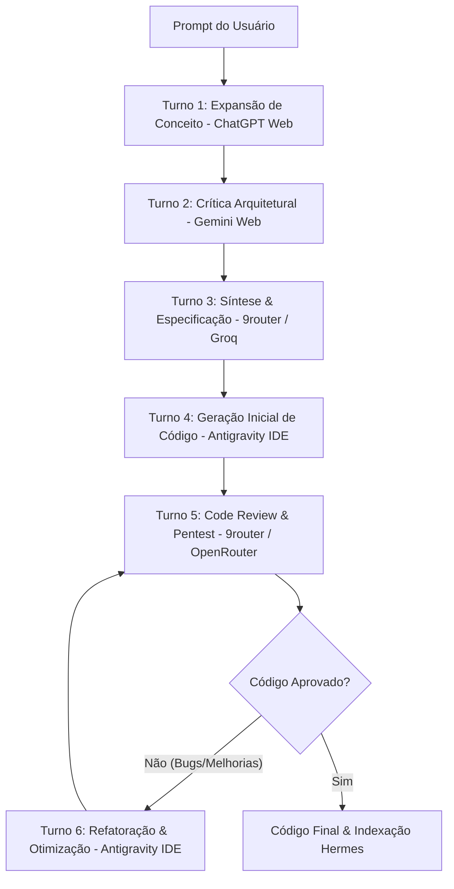

# Idealização & Conceito do Projeto (GDD)
## Orquestrador Multi-Agentes de 3 Camadas (LLM Routing & Debate Automation)

---

## 💡 1. Visão Geral & Propósito do Projeto

O **Orquestrador Multi-Agentes de 3 Camadas** é um ecossistema de software projetado para maximizar a capacidade de raciocínio, disponibilidade e eficiência de Modelos de Linguagem (LLMs), operando sob uma premissa estrita de **custo zero** e **alta resiliência**.

O sistema resolve três grandes limitações do uso convencional de IAs:
1. **Limites de Uso (*Rate Limits*) e Bloqueios:** Transiciona automaticamente entre diferentes provedores e camadas caso um modelo fique indisponível, sofra alteração de layout no site ou atinja a cota gratuita.
2. **Latência e Custos de Rede:** Executa tarefas simples ou locais no próprio dispositivo do usuário sem depender da nuvem.
3. **Qualidade de Raciocínio Monolítico:** Em vez de confiar no retorno de uma única IA, estabelece uma "sala de conferência" (debate colaborativo) com ciclo de aprimoramento incremental de código, onde múltiplos modelos analisam, criticam, sintetizam, constroem e revisam o software antes da entrega final.

---

## 🛠️ 2. Mapeamento de Ferramentas e IAs por Camada

Para prever o comportamento exato do sistema, as ferramentas e modelos são categorizados de forma transparente:

| Camada | Tipo de Ferramenta | Provedores & Modelos Alvo | Método de Conexão | Função Principal |
| :--- | :--- | :--- | :--- | :--- |
| **Camada 3** | Official Web & IDEs (Superfície) | • Antigravity IDE (Gemini 2.5 / Claude) • ChatGPT Web (GPT-4o / GPT-4o-mini) • Gemini Web (Gemini Advanced / Flash) | • Playwright RPA (PC) • Tasker / UIAutomator (Mobile) • Contexto Direct IDE | Raciocínio pesado, arquitetura, crítica profunda e geração inicial de código. |
| **Camada 2** | APIs Externas Não-Locais (Intermediária) | • Groq Cloud (Llama 3.3 70B, Llama 3.1 8B, Mixtral) • OpenRouter Free (DeepSeek-R1 / V3, Qwen 2.5 Coder) • 9router Proxy Hub | • API REST JSON (`/v1/chat/completions`) | Roteamento rápido, síntese de consenso, sanitização, mediação e fallback imediato. |
| **Camada 1** | Inferência Local (Profunda) | • Hermes / Gemma 2B • Llama 3.2 3B / Llama 3 8B Quantizado (Q4_K_M) | • Llama.cpp Server (`localhost:8080`) / MLC LLM | Operação 100% offline, privacidade, assistente de suporte dedicado e RAG local. |

---

## 🔄 3. O Fluxo do Debate Moderado & Aprimoramento Incremental de Código

O **Padrão Blackboard** (histórico vivo em `conferencias/<nome-do-projeto>/projeto_atual.md`) opera através de um loop expansível de **7 turnos padronizados**, focado não apenas em debate de conceitos, mas no **refinamento estrito de código**:

### Detalhamento dos Turnos:
1. **Turno 1 - Expansão de Conceito (ChatGPT Web / GPT-4o):** Analisa a intenção bruta do usuário e gera uma proposta arquitetural abrangente.
2. **Turno 2 - Crítica & Regras de Borda (Gemini Web / Gemini Flash):** Questiona gargalos, falhas de lógica, concorrência e riscos de segurança da proposta do Turno 1 (sem escrever código ainda).
3. **Turno 3 - Síntese de Consenso (9router - Llama 3.3 70B via Groq):** Filtra o debate, remove contradições e gera um blueprint técnico enxuto em Markdown.
4. **Turno 4 - Geração Inicial de Código (Antigravity IDE / Modelo de Código):** Consome a síntese do Turno 3 e constrói a primeira versão funcional dos arquivos de código.
5. **Turno 5 - Code Review & Audit de Segurança (Gemini Web ou DeepSeek via OpenRouter):** Inspeciona o código gerado no Turno 4 em busca de bugs, vazamentos de memória, erros de sintaxe ou violação de Clean Architecture.
6. **Turno 6 - Refatoração & Aprimoramento (Antigravity IDE):** Aplica as correções apontadas no Turno 5, refatorando o código para sua versão definitiva e otimizada.
7. **Turno 7 - Loop de Feedback de Testes (Iterativo):** Se a execução do código no ambiente local reportar erro ou falha de teste, o log do erro é inserido no `.md` e o fluxo retorna ao Turno 5 para correção guiada.
8. **Modo Observador Passivo (Hermes Local):** Absorve o documento finalizado para indexação local de conhecimento (RAG/Embeddings).

---

## 🔀 4. Fluxos Opcionais de Contingência (Fallbacks & Comportamentos Esperados)

Para garantir resiliência total, o Maestro (Gateway Python) avalia continuamente a saúde das conexões e serviços, aplicando desvios automáticos:

### Cenário A: Operação Nominal (Todas as Camadas Online)
* **Comportamento Esperado:** Execução completa dos 7 Turnos com máxima qualidade e verificação cruzada entre Web RPA, APIs e Antigravity IDE.

### Cenário B: Bloqueio/Quebra de Web Scraping na Camada 3 (CAPTCHA, Timeout ou Mudança de Layout)
* **Condição de Disparo:** Falha no script Playwright (ex: elemento CSS não encontrado ou timeout de 15s).
* **Comportamento Esperado:**
  1. O Maestro registra o alerta no log e isola a ferramenta web com falha.
  2. Redireciona os papéis de Expansão/Crítica para a **Camada 2** (usando DeepSeek-R1 / Llama 3.3 70B via OpenRouter / Groq no 9router).
  3. A geração final de código permanece na **Antigravity IDE** via contexto do projeto.

### Cenário C: Queda Parcial de Rede / Rate Limit em APIs Externas (Camada 2 Instável)
* **Condição de Disparo:** Retorno de código de erro HTTP `429 Too Many Requests` ou `503 Service Unavailable` em proxies do 9router.
* **Comportamento Esperado:**
  1. O Maestro realiza a rotação automática de chave/endpoint dentro do 9router.
  2. Se todos os proxies da Camada 2 falharem, o fluxo simplifica o debate executando a síntese via **Hermes Local (Camada 1)**.

### Cenário D: Queda Total de Internet / Modo Offline Absolute
* **Condição de Disparo:** Falha de ping em DNS externo ou ausência de interface de rede ativa.
* **Comportamento Esperado:**
  1. O Maestro chaveia 100% da operação para a **Camada 1 (Hermes Local)**.
  2. O loop de debate reduz-se a um fluxo enxuto de 2 turnos (Rascunho Local $\rightarrow$ Refatoração Local) para preservar CPU/bateria do aparelho.

### Cenário E: Requisição Trivial de Baixa Complexidade
* **Condição de Disparo:** Prompt com contagem de tokens reduzida (< 150 tokens) ou palavras-chave de utilitários (ex: *"gerar regex de email"*, *"formatar JSON"*).
* **Comportamento Esperado:**
  1. O Maestro desativa o loop longo de debate.
  2. Despacha a requisição diretamente para o modelo ultra-rápido no Groq (Camada 2 - resposta sub-segundo) ou Hermes Local (Camada 1), economizando tempo do usuário.

---

## 📁 5. Arquitetura Multi-Projeto & Isolamento de Contexto

Este Orquestrador opera como uma **ferramenta utilitária de governança reutilizável**, integrando-se nativamente à estrutura base de **`Diretrizes/`** de todos os projetos do desenvolvedor:

1. **Adesão Estrita ao Template Base (`Diretrizes/`):**
   * O sistema lê e respeita rigorosamente as regras globais descritas em `Diretrizes/GEMINI.md`, `Diretrizes/.agents/rules/` e `Diretrizes/docs/metodologias-e-fluxo.md`.
2. **Particionamento Estrito por Pastas Dedicadas por Projeto:**
   * Cada projeto possui sua própria pasta isolada em `conferencias/<nome-do-projeto>/`.
   * Todos os históricos de debate, logs e arquivos de contexto `.md` são **permanentemente preservados** em sua respectiva pasta de projeto. Alternar entre projetos apenas muda a pasta ativa carregada pelo sistema, mantendo os dados de todos os projetos 100% salvos e intocados.
3. **Definição Clara de "Ambiente Limpo" (*Clean Slate*):**
   * O termo "Ambiente Limpo" significa simplesmente **criar ou selecionar uma nova pasta vazia** para um novo projeto, onde não existe histórico de conversação anterior carregado na sessão ativa. **Nenhum contexto ou log de projetos passados é apagado.**
4. **Memória Passiva Global do Hermes (Aprendizado Inter-Projetos):**
   * Embora o histórico de chat fique restrito à pasta de cada projeto, o modelo local **Hermes (Camada 1)** extrai e indexa continuamente os aprendizados técnicos finalizados (embeddings RAG de padrões de código, soluções de bugs e boas práticas) em uma memória vetorial global. Dessa forma, o Hermes preserva o conhecimento técnico acumulado entre múltiplos projetos sem misturar o contexto de conversas passadas.

---

## 🖥️ 6. Interfaces de Uso & Funcionalidades Detalhadas do Usuário Final

Para garantir que o usuário tenha **controle total, visibilidade transparente e alta operabilidade**, o sistema disponibiliza um catálogo expandido de funcionalidades acessíveis por múltiplos pontos de entrada.

### 6.1. Catálogo Expandido de Funcionalidades do Usuário

#### 💬 A. Interação & Comunicação com IAs
1. **Visualização em Tempo Real do Debate ("Mesa Redonda" Streaming):**
   * *Funcionamento:* Acompanhamento ao vivo e em streaming da conversa entre as IAs. Cada turno exibe um card com o nome do agente, seu papel no loop (Expansão, Crítica, Síntese, Código, Audit, Otimização), a camada de processamento ativa e o texto sendo gerado em tempo real.
2. **Chat de Interação Direta no Fluxo (In-Stream Direct Chat):**
   * *Funcionamento:* Permite que o usuário envie mensagens e comandos DIRETAMENTE para a Mesa Redonda no meio do debate. O usuário atua como participante ativo da conferência (ex: *"Usuário: Por favor, altere a síntese para utilizar o banco SQLite local"*). Suporta menções diretas com `@` para direcionar instrução a uma IA específica (ex: `@Gemini refaça a análise focando em concorrência`).
3. **IA Dedicada Externa ao Fluxo (Assistente de Suporte, Árbitro & Coletor):**
   * *Funcionamento:* Um agente de IA dedicado (configurável, ex: Hermes Local ou Groq rápido) que opera FORA da Mesa Redonda e exerce três papéis estratégicos:
     * **IA Árbitro (Juiz de Impasse):** Invocado automaticamente se duas IAs no debate entrarem em contradição insolúvel ou loop de divergência, dando o voto de minerva imparcial.
     * **IA Coletor (Web Searcher & Retriever):** Busca documentações técnicas externas, código atualizado ou dados locais sob demanda e injeta as referências diretamente no `.md` sem interromper a conferência principal.
     * **Assistente de Dúvidas do Usuário:** Chat isolado e permanente onde o usuário tira dúvidas pontuais sobre a arquitetura do software sem poluir a memória do debate.

#### 📊 B. Telemetria, Cotas & Diagnóstico de Hardware
4. **Monitor de Cotas de Tokens & Cronômetro de Reset:**
   * *Funcionamento:* Exibe o consumo acumulado de tokens de entrada e saída por provedor (Groq Cloud, OpenRouter, ChatGPT Web, Gemini Web). Inclui cronômetros regressivos dinâmicos indicando exatamente quanto tempo falta para o reset das cotas gratuitas diárias/horárias de cada serviço.
5. **Identificação Transparente de Modelos & Origem Ativa:**
   * *Funcionamento:* Marcação clara em cada mensagem do debate especificando a **Origem** (Camada 3 Web RPA, Camada 2 API 9router, Camada 1 Hermes Local), o **Provedor de Hospedagem** (OpenAI, Google, Groq, OpenRouter, Hardware Local) e o **Modelo Específico** (ex: `gpt-4o-mini`, `llama-3.3-70b-versatile`, `gemma-2b-q4`).
6. **Telemetria de Hardware Local (RAM, VRAM, CPU & Latência):**
   * *Funcionamento:* Monitoramento contínuo dos recursos do aparelho. Exibe a quantidade exata de memória RAM e VRAM alocada pelos modelos locais (Hermes / Llama.cpp), uso de CPU, latência da primeira resposta (TTFT - *Time to First Token*) e velocidade de geração em tokens por segundo (t/s).

#### 📁 C. Gerenciamento de Projetos, Arquivos & Governança
7. **Gerenciador Avançado de Pastas, Projetos & Workspaces:**
   * *Funcionamento:* Explorador de arquivos e gerenciador de projetos integrado. Permite criar novos projetos, alternar entre workspaces existentes, duplicar estruturas, criar subpastas e aplicar modelos de governança da pasta `Diretrizes/`. Inclui gerador de backups compactados (`.tar.gz`) do projeto ativo.
8. **Navegação para Ambiente Limpo (*Clean Slate* via Pasta Vazia):**
   * *Funcionamento:* Alternância/criação de uma nova pasta de projeto vazia, garantindo que a nova sessão inicie sem contexto de conversas anteriores carregado, enquanto preserva 100% intactos os logs e contextos de projetos passados em suas respectivas pastas.
9. **Leitor/Editor Vivo do Quadro Branco (`.md`):**
   * *Funcionamento:* Visualizador Markdown integrado e sincronizado ao vivo com o arquivo `conferencias/<projeto>/projeto_atual.md`. Permite que o usuário insira anotações manuais ou edite o contexto antes de disparar o próximo turno.

#### ⚙️ D. Configuração, Controle Manual & Ferramentas Úteis
10. **Gerenciador & Adição Manual de Novas IAs/Provedores:**
    * *Funcionamento:* Painel de configuração onde o usuário pode cadastrar manualmente novas chaves API (Groq/OpenRouter), registrar novos endpoints REST compatíveis com a OpenAI, adicionar conectores para novas IAs Web (ex: Claude Web, DeepSeek Web) ou ajustar rotas do 9router.
11. **Controle de Fluxo Manual & Intervenção Humana (*Override*):**
    * *Funcionamento:* Botões de controle para **Pausar o Debate** a qualquer momento, **Forçar a Troca de Agente** (ex: substituir Gemini por DeepSeek no próximo turno), **Editar a Resposta da IA** antes de passar a bola, ou **Forçar o Modo 100% Offline**.
12. **Sistema de Replay & Testes A/B de LLMs:**
    * *Funcionamento:* Permite reprisar debates anteriores alterando modelos ou parâmetros de sistema para comparar visualmente qual combinação de IAs gerou o código de melhor qualidade.
13. **Exportador Automático de Documentação (DocGen):**
    * *Funcionamento:* Compila automaticamente a árvore do projeto, o histórico do debate e os arquivos de código em documentos finais formatados (PDF, HTML, README.md, GDD e especificação de API).
14. **Modo Sandbox de Execução Segura de Código:**
    * *Funcionamento:* Ambiente de testes isolado que compila e executa o código gerado nos Turnos 4 e 6 em um subprocesso seguro, injetando o resultado do teste de execução diretamente no Turno 7 para correção imediata.

---

### 6.2. Modos de Acesso & Experiência do Usuário (UX)

O usuário acessa todas as funcionalidades acima através de **3 interfaces dedicadas**:

#### A. Dashboard Web Local (Navegador - SPA)
* **Acesso:** `http://localhost:8000/dashboard` (Interface gráfica leve em HTML5/CSS Vanilla com WebSockets).
* **Navegação por Abas:**
  * 💬 **Aba "Debate ao Vivo":** Painel principal em 3 colunas:
    * *Coluna Esquerda:* Leitor de arquivos e árvore de pastas do projeto ativo.
    * *Coluna Central:* Chat do debate ao vivo com streaming dos 7 turnos, cartões de identificação de modelos, caixa de chat de injeção direta no fluxo e botões de override/pausa.
    * *Coluna Direita:* Quadro Branco `.md` ao vivo e chat lateral com a **IA Dedicada (Árbitro/Assistente)**.
  * 📊 **Aba "Telemetria & Cotas":** Dashboard gráfico mostrando velocímetros de RAM/VRAM consumidas pelo Hermes local, medidores de latência (ms e t/s) e cartões de cotas de API com contagem regressiva para o reset de cada provedor.
  * ⚙️ **Aba "Gerenciador de IAs":** Formulário intuitivo para adicionar novas chaves de API, cadastrar novos modelos, configurar seletores de RPA e ajustar preferências de fallback.
  * 📁 **Aba "Workspaces & Projetos":** Explorador visual de projetos com opções de clonagem, backup, exportação e botão de navegação para ambiente limpo (*Clean Slate*).
  * 🧪 **Aba "Replay & Sandbox":** Ferramenta para testes A/B de modelos e ambiente isolado para execução de código gerado.

#### B. Interface CLI de Terminal (`maestro-cli`)
* **Acesso:** Linha de comando no terminal (`python3 -m maestro` ou `./maestro-cli`).
* **Navegação Interativa (Rich TUI):**
  * Painel dividido no terminal com cores vibrantes destacando o papel de cada IA, velocidade (t/s) e consumo de memória.
  * Menu de navegação por atalhos de teclado: `Tab` para alternar entre telas (Debate, Telemetria, Arquivos, Assistente Dedicado), `Ctrl+P` para pausar o debate e intervir manualmente.
  * **Comandos Diretos:**
    * `maestro --project <nome>` (Seleciona ou cria workspace em pasta vazia)
    * `maestro --status` (Exibe telemetria de RAM/VRAM, latência e cotas)
    * `maestro --add-ai` (Assistente no terminal para cadastrar nova IA ou chave API)
    * `maestro --offline` (Força chaveamento para a Camada 1 Hermes Local)
    * `maestro --arbitrate` (Aciona a IA Árbitro para resolver impasse)
    * `maestro --export` (Exporta documentação formatada do projeto)

#### C. Gateway Proxy Transparente (OpenAI API Compatible)
* **Acesso:** `http://localhost:8000/v1/chat/completions`.
* **Uso:** Conexão direta com IDEs (Antigravity IDE, VS Code, Cursor). Os metadados de telemetria (cotas, RAM, modelo ativo e camada) são transmitidos de forma transparente nos cabeçalhos HTTP da resposta (`X-Maestro-Layer`, `X-Maestro-Model`, `X-Maestro-RAM-Used`, `X-Maestro-Quota-Reset`).

---

## 🛠️ 7. Automação de Interface & RPA Persistente

Para viabilizar a utilização das plataformas oficiais da Camada 3 sem custos de API:
* **No PC (Linux):** Utilização de automação de navegador via **Playwright Python** operando com **Contexto Persistente** (`user_data_dir`), mantendo a sessão ativa e logada no navegador do usuário.
* **No Celular (Android):** Integração entre scripts Python no Termux e automação de área de transferência/ações de tela via Tasker/AutoInput quando aplicável.

---

## 🎯 8. Objetivos Centrais de Sucesso do Projeto

* **Custo Zero Garantido:** Operação contínua baseada exclusivamente em tiers gratuitos e execução local.
* **Disponibilidade Permanente:** Resiliência contra quedas de internet, rate-limits e bloqueios de RPA.
* **Múltiplas Interfaces de Uso:** Suporte a Dashboard Web completo (3 colunas), CLI rica no Terminal e Proxy para IDEs.
* **Inteligência Auxiliar Dedicada:** Suporte a IA Árbitro para impasses, IA Coletora para buscas e Chat de Suporte ao Usuário.
* **Controle & Telemetria Total:** Visibilidade de RAM/VRAM, tempo de reset de cotas, modelos ativos, bate-papo in-stream e intervenção manual (*Override*).
* **Qualidade de Código Auditada:** Ciclo de code review obrigatório e Sandbox de testes antes de aceitar qualquer código gerado.
* **Preservação Multi-Projeto & Aprendizado Global:** Garantia de pastas exclusivas por projeto com preservação integral de logs e aprendizado técnico passivo acumulado no Hermes.
* **Transparência & Auditabilidade:** Registro legível de todo o processo em arquivos Markdown (`.md`).
